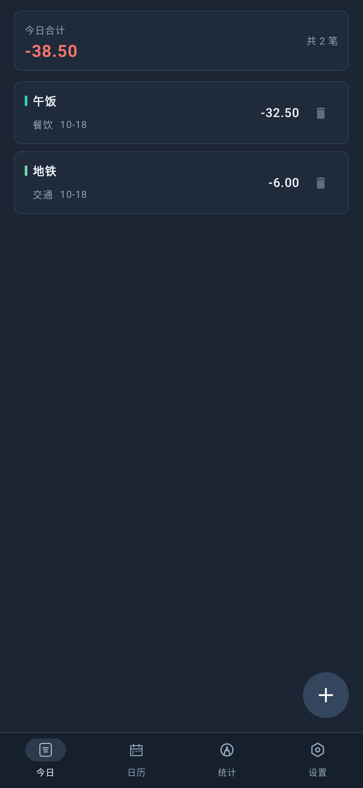
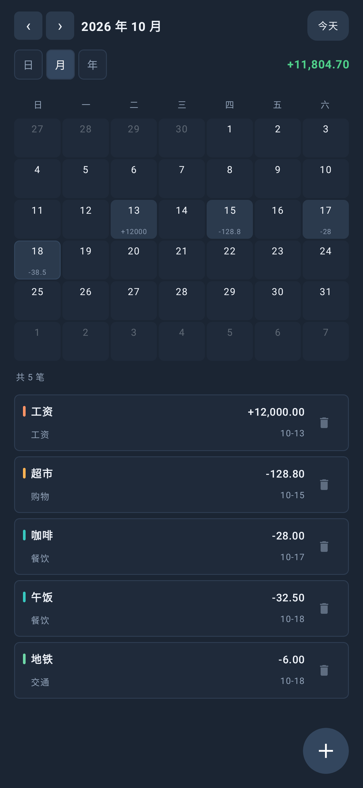
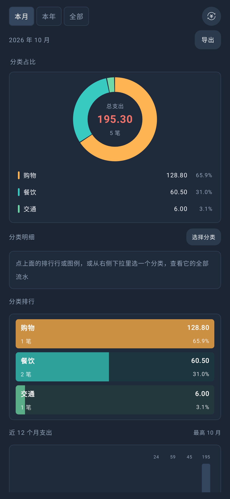
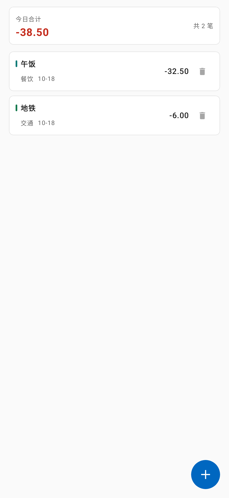
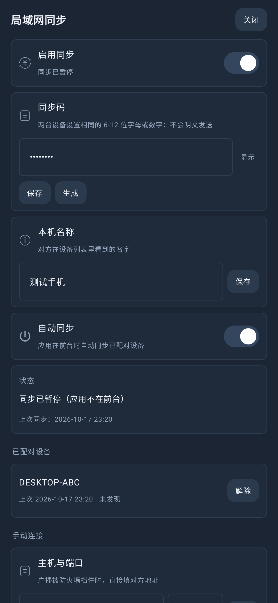
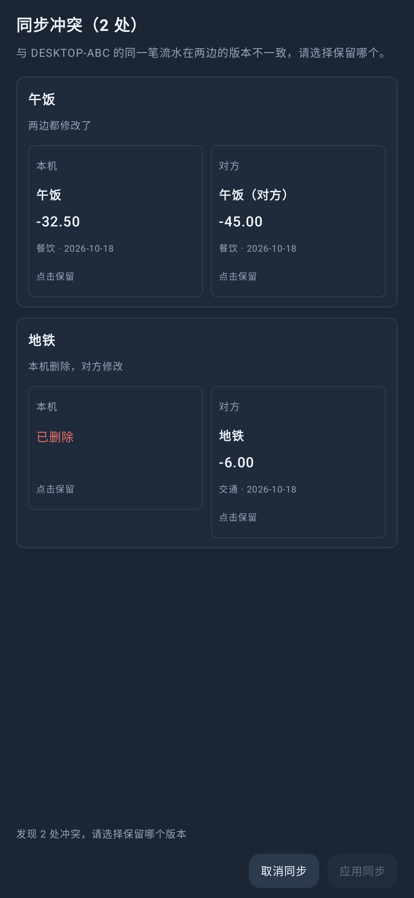

# PaperCoin Android

PaperCoin 的 Android 版，Kotlin + Jetpack Compose 实现。功能与桌面版对齐：今日账单、日历（日 / 月 / 年）、
统计（圆环 / 排行 / 分类下钻 / 12 个月趋势）、设置（6 套主题、更新检查、备份导入导出）。

这是独立的 Gradle 工程，不在根目录 `PaperCoin.sln` 里；桌面版与 Android 版共用同一套账单 JSON 格式。

## 界面预览

<p>
  
  
  
  
</p>

<p>
  
  
</p>


## 环境

- JDK 17+（本机用 JDK 21）
- Android SDK Platform 35、Build-Tools 35.0.0
- Gradle Wrapper 8.11.1（仓库已带，无需本机装 Gradle）

`local.properties` 里的 `sdk.dir` 指向 SDK：

```properties
sdk.dir=D\:\\Android\\Sdk
```

## 构建

```powershell
# 调试包（可直接安装）
.\gradlew.bat :app:assembleDebug
# 产物：app/build/outputs/apk/debug/app-debug.apk

# 发布包（需要 keystore.properties，见下）
.\gradlew.bat :app:assembleRelease
# 产物：app/build/outputs/apk/release/app-release.apk
```

安装：

```powershell
adb install -r app/build/outputs/apk/release/app-release.apk
```

包名 `com.ksayus.papercoin`，`minSdk 26`（Android 8.0），`targetSdk 35`。

## 签名

`keystore.properties` 与 `keystore/papercoin-release.jks` 是本机的发布签名材料，已被 `.gitignore` 排除：

```properties
storeFile=keystore/papercoin-release.jks
storePassword=<your-store-password>
keyAlias=papercoin
keyPassword=<your-key-password>
```

实际密码只保存在本机的 `keystore.properties`，不要提交到仓库。

**这两个文件必须备份。** 以后发新版必须用同一把钥匙签名，否则已经安装的旧版无法覆盖升级
（Android 会拒绝安装签名不同的包）。没有 `keystore.properties` 时 `assembleRelease` 仍能出包，但产物未签名。

## 版本

Android 版 `1.3.9`，`versionCode = 10309`。桌面版当前也是 `1.3.9`；同步协议 v1 与版本号无关，两端可以混用。
以后发版改两处：`app/build.gradle.kts` 的 `versionName` 与 `versionCode`。`versionCode` 必须递增，光改
`versionName` 不会让系统认为有新版本。

更新检查走 GitHub Releases（可切 Gitee），只认资产里的 `.apk`。发布 Android 更新时请把 APK 作为
Release 资产上传；没有 APK 时设置页会显示“需手动下载”，不会误报可安装。

## 数据

运行时数据在应用私有目录：

```
/data/user/0/com.ksayus.papercoin/files/PaperCoin/
├── Bills/<年>/<月>/<日>/bills.json
├── Config/papercoin-settings.json
```

与桌面版 `%APPDATA%\PaperCoin\` 的结构、字段名、日期格式、金额数字格式一致。两条迁移路径：

- **导入备份**：ZIP（整棵 `Bills/` + 配置）或直接选桌面版拷到手机上的 `Bills` 文件夹（SAF 树选择器）。
  按 `id` 合并，同一天里备份中没有的记录一条不丢。导入**只合并账单**，不会覆盖当前的主题与更新设置。
- **导出备份**：同样打 ZIP，存到用户选择的位置。

CSV 导出在统计页，UTF-8 带 BOM，Excel 直接打开不乱码。

## 与桌面版不同的地方

| 桌面 | Android |
|---|---|
| 左侧导航栏 | 手机底部 Tab；宽度 ≥ 600dp 时自动切左侧导航栏 |
| 480×640 无边框窗口 | edge-to-edge，状态栏 / 导航栏取主题色 |
| 居中浮层编辑面板 | ModalBottomSheet，字段与校验语义不变 |
| DWM 背板真模糊 | 应用内渐变 + 柔和光斑 + 半透明面板（Android 不允许应用模糊窗口背后的内容） |
| 注册表开机自启 | 去掉（Android 没有等价能力） |
| MSI 更新 | 下载 APK 并交给系统安装器；需要用户允许“安装未知来源应用” |
| 资源管理器打开数据目录 | 显示私有路径，用导出 / 导入代替 |

## 局域网同步

Android 与 Windows 桌面版、Android 与 Android 之间可以在同一局域网自动同步账单。

使用步骤：

1. 两端都在设置页打开「局域网同步」。
2. 在其中一端点「生成」得到 8 位同步码，在另一端输入并保存同一个码。
3. 第一次在「发现的新设备」里点「同步」（或填对方 `主机:端口` 手动连接）。
4. 成功后两端自动记住对方；以后应用在前台时每 20 秒发现并同步一次，Windows 端在程序运行期间同样自动。

冲突处理：

- 同一笔流水两边都改过，或一边删除、另一边修改时，会弹出**同步冲突**页。
- 每一条冲突都要选「保留本机」或「保留对方」，再点「应用同步」。
- 点「取消同步」则整次同步不落盘，非冲突的改动也不会先写一半。
- 应用前两端都会校验快照哈希；如果同步期间有人改了账，整次同步作废并提示重试。

实现细节：

- UDP 47831 发现设备，TCP 47832（占用时自动换端口并在发现包中广播实际端口）。
- 协议、哈希算法、合并规则与冲突语义见 [docs/lan-sync-protocol.md](../docs/lan-sync-protocol.md)。
- 同步状态与基线在 `Sync/papercoin-sync.json`，不写进账单 JSON。
- Android 退到后台会停止监听，回到前台恢复；没有常驻前台服务。

注意：

- 只在可信局域网使用。传输没有 TLS 加密，同网段的嗅探者可以看到账单内容；同步码只用于阻止误连。
- Windows 端第一次监听时 Windows Defender 防火墙可能询问是否允许，需要放行专用网络。
- 广播被路由器或防火墙挡住时，用「手动连接」填对方 IP 和端口即可。

## 测试

```powershell
.\gradlew.bat :app:testDebugUnitTest
```

- 数据层：账单读写、按 Id 删除不误伤其它日期、改日期移动记录、坏文件跳过、分类汇总、统计口径、
  FNV-1a 分类色槽、CSV 转义、JSON 与桌面版互读。
- 同步层：协议哈希向量、三方合并/冲突/删除传播/日期移动，以及同进程 TCP 回环的完整握手与两端收敛。
- 界面：`ScreenshotTest` 用 Robolectric 的 NATIVE 图形渲染真实页面，PNG 在 `app/build/screenshots/`。
  首次运行需要 `android-all-instrumented` 包；工程默认走阿里云镜像，若本机已把 jar 放到
  `robolectric-deps/` 就完全离线。

> 本机没有可用的 Android 模拟器（Windows Hypervisor Platform 关闭），所以最终触屏体验需要在真机上验证；
> 有手机并打开 USB 调试时可以直接 `adb install` 后抓截图。

## 项目结构

```
PaperCoin.Android/
├── app/src/main/java/com/ksayus/papercoin/
│   ├── core/       分类色板、格式化、日志
│   ├── data/       模型、仓库、配置、统计、CSV、备份、更新
│   ├── ui/         主题（6 套调色板）、通用组件、四个页面、导航
│   └── vm/         四个页面状态 + 共用编辑器状态
├── app/src/main/res/  iconfont.ttf、自绘图标、主题资源
└── app/src/test/      数据层单测 + Robolectric 截图
```

## 已知取舍

- “液态玻璃”是应用内近似，不是真的窗口背后模糊；透明度与颜色键仍按桌面版调色板。
- 没有云同步、没有多设备冲突合并；跨设备靠备份 ZIP 手动搬。
- 不启用 R8 / 资源压缩（`isMinifyEnabled = false`），首版优先可读与可调试；后续可单独开启。
